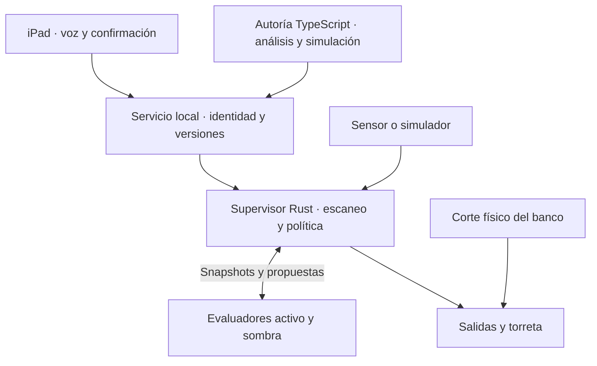
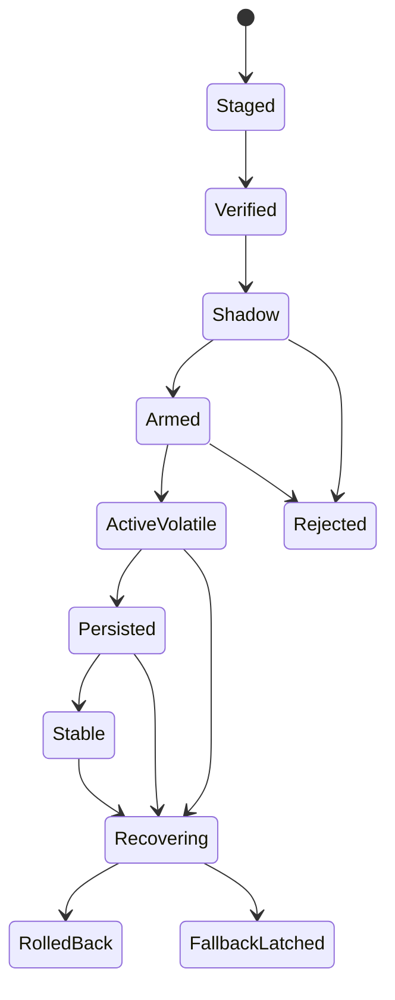

# PLC Automático — megaplan de implementación

**Versión 1.0 · 22 de noviembre de 2026 · California**  
**Alcance** — Autoría por voz, cambio de reglas en RUN y sustitución de módulos de control en un banco Linux edge. El banco de referencia usa un Luckfox Lyra PLC, un iPad Air M4, un sensor de temperatura y humedad TZONE THT-02 o su simulador, y una torreta indicadora de baja tensión. El modelo exacto de los equipos se confirma en Fase 0.

## 1. Decisión de arquitectura

Construir un **supervisor de control en Rust** que posea las entradas, las salidas, el reloj de ciclo, los temporizadores y la decisión de activar o revertir una versión. Construir en **TypeScript** el catálogo de reglas, la representación intermedia, la validación de propuestas, el simulador y la consola de autoría. En el iPad, usar Swift para capturar voz y conectar con la API local. Para ejecutar lógica nueva, probar **AssemblyScript → Wasm → WAMR AOT** en el Lyra ARMv7. Correr el motor en un proceso subordinado aislado. Comparar esa ruta contra un intérprete de reglas acotado, QuickJS-NG y Wasmtime bajo el mismo contrato de ciclo.

El primer producto tiene dos operaciones distintas y cada una tiene su propia prueba:

| Operación | Qué cambia | Qué sucede en el PLC | Evidencia de éxito |
| --- | --- | --- | --- |
| Actualizar una regla en RUN | Umbral, tiempo, comportamiento o selección de una plantilla | El mismo evaluador usa la nueva revisión desde una frontera de ciclo | Secuencia de ciclos continua, revisión leída del supervisor, trazas de entrada y salida |
| Sustituir lógica en RUN | El artefacto de un evaluador añade o cambia comportamiento | En una frontera de ciclo, el supervisor selecciona un módulo ya verificado, precalentado y compatible | Hash de módulo diferente, continuidad del escaneo, estado documentado, transición física medida y rollback probado |

La primera operación entrega la demo por voz. La segunda resuelve la hipótesis del deep research. **La Fase 2 solo cierra cuando ambas se han demostrado en banco.** Una modificación de E/S, del supervisor, del período de ciclo, de la envolvente o de un esquema incompatible requiere un flujo de mantenimiento. Cambiar esas propiedades queda fuera de la sesión de voz.

### Navegación

- [2. Fuentes y decisiones](#2-fuentes-y-decisiones)
- [3. Contratos de arquitectura](#3-contratos-de-arquitectura)
- [4. Fase 0 — factibilidad y pruebas sintéticas](#4-fase-0--factibilidad-y-pruebas-sintéticas)
- [5. Fase 1 — núcleo, I/O y hot-swap](#5-fase-1--núcleo-io-y-hot-swap)
- [6. Fase 2 — TypeScript, voz e IEC 61131-3](#6-fase-2--typescript-voz-e-iec-61131-3)
- [7. Fase 3 — producto y migración ARM64](#7-fase-3--producto-y-migración-arm64)
- [8. Matriz de pruebas y entrega](#8-matriz-de-pruebas-y-entrega)
- [9. Referencias](#9-referencias)

## 2. Fuentes y decisiones

El informe [Control Edge Hot-Swap Seguro.docx](https://chatgpt.com/library?file_id=libfile_d214783f5a788191b95839e31b8e8809&account_id=personal), en particular sus páginas 11–22 y 28–29, aporta las rutas A1–A7, el arnés sintético y la hoja de ruta de cuatro fases. El [megaprompt del PLC Automático](https://chatgpt.com/library?file_id=libfile_88734cc056cc8191920e686175276ce9&account_id=personal) aporta el escenario del iPad, el THT-02 y la torreta, además de los casos de voz. Las cifras de RAM, jitter, carga y rollback de la investigación son **estimaciones o metas de experimentación**. En este documento, **documentado** significa que la fuente lo publica, **propuesto** que es una decisión de diseño y **pendiente** que requiere prueba o identificación del equipo. La redacción del plan incluyó revisión documental. La ejecución de las fases producirá las mediciones sobre hardware.

| Punto crítico | Evidencia disponible | Decisión de implementación |
| --- | --- | --- |
| Modelo de PLC | Luckfox documenta para el Lyra un RK3506B Cortex-A7, 512 MB, 8 GB eMMC, Linux, RS-485/RS-422, dos relés y LCD. La documentación del módulo identifica un Cortex-M0. [R1–R4] | Inventariar la unidad. Las pruebas comienzan con Linux ARMv7 bajo la hipótesis Lyra. Voz e inferencia en el iPad/Mac. Cualquier NPU, cifra TOPS o uso del M0 por el firmware necesita evidencia de la unidad. |
| Tres colores | Dos canales independientes. NO y NC de un canal conmutan el mismo común. [R1–R2] | Usar dos colores físicos y uno virtual al principio. Para tres físicos, calificar una tercera salida y su comportamiento al perder comunicación o alimentación. |
| Propiedad del GPIO | Luckfox documenta mapeo de relés a GPIO17/GPIO18 y advierte sobre la gestión de la WebUI. [R2] | Un propietario por canal y bus. Calibrar los nombres y offsets en el dispositivo. Detener y verificar el componente de fábrica que escribe relés antes de levantar otro runtime. |
| OpenPLC | El tutorial de Luckfox demuestra integración. La API oficial de Runtime v4 indica parada durante la compilación al cargar el programa por su ruta de upload. [R2, R5] | Comparador de ingeniería y prueba opcional de selección de reglas en RUN. El hot-swap de artefactos pertenece al supervisor propio. |
| Compatibilidad de TypeScript | El tipado se elimina al transpilar. AssemblyScript es un dialecto y su runtime `stub` no libera memoria. Node clasifica ARMv7 como experimental desde v24. [R8–R10] | Separar TypeScript de autoría del motor. Limitar el código de escaneo, evitar asignación por ciclo y medir el binario exacto; priorizar armhf y ARM64 por separado. |
| Garantía temporal | PREEMPT_RT cambia el comportamiento de planificación. Una traza de temporizador mide latencia del sistema y el arnés mide además el recorrido de la aplicación. [R11] | Comparar kernel de fábrica y RT si hay imagen o build recuperable. Publicar máximos observados y condiciones. La latencia de sensores y relés tiene presupuestos propios. |
| Seguridad de maquinaria | ISO 13849-1 trata partes de sistemas de control relacionadas con seguridad. IEC 60204-1 trata el equipo eléctrico de máquinas. NIST SP 800-82 Rev. 3 aborda seguridad OT. [R12–R14] | Banco con indicadores de baja tensión y corte físico accesible. Para maquinaria, derivar el estado seguro y el tiempo de reacción del análisis de la aplicación. El supervisor, la IA y un watchdog genérico tienen alcance de control operativo y diagnóstico. |
| Estado del arte | Simplex divide controlador avanzado, decisión y recuperación. Kitsune aporta puntos explícitos de actualización y transferencia de estado. Hay precedentes de PLC en caliente, como el Online Change elegible de CODESYS y lo declarado por KronEditor. [R6–R7, R15–R17] | La hipótesis de producto es la combinación medible de voz local, intención revisable, aislamiento, trazas y recuperación en un equipo económico. Comparar contra HMI y flujo de ingeniería convencional. |

### 2.1 Qué aporta cada mecanismo

| Mecanismo | Implementación en este producto | Dónde se valida |
| --- | --- | --- |
| Simplex y Run-Time Assurance | Política fija del supervisor, salida de respaldo, prioridad por fallo y bloqueo tras reincidencias | Fases 0 y 1 |
| Escudos reactivos | Máscaras permitidas, exclusión mutua configurada, frescura, límites de frecuencia y prioridad de la orden de apagado | Fase 1 |
| Actualización dinámica en punto quiescente | Entrada y estado con dueño fijo. Selección de versión solo en frontera. Migración tipada y salida de respaldo | Fase 1 |
| Sombra y replay | Misma entrada y tiempo lógico. La sombra usa un estado privado y solo entrega propuestas a un sumidero de verificación | Fases 0 y 1 |
| Transferencia bumpless | Para señales discretas, transición definida y medida. Para PID opcional, seguimiento de salida aplicada y migración específica | Fases 1 y 3 |
| Separación padre/hijo | Proceso con E/S exclusiva y evaluadores con IPC acotado. Equivale a conservar una raíz estable y reemplazar módulos de comportamiento | Fases 0 y 1 |
| Tiempo lógico | Fecha de snapshot, número de ciclo y reloj monotónico provistos por el host | Fases 0 a 3 |
| CBF para control continuo | Extensión experimental para una planta identificada, modelada y validada | Fase 3, condicionada al caso de uso |

## 3. Contratos de arquitectura

### 3.1 Topología del banco



**Control** reside en el Lyra. **Autoría y compilación** pueden residir en el Mac. **Interacción** puede residir en el iPad o la consola local. El proceso del supervisor es el único dueño lógico de control. Puede delegar el descriptor del bus a un driver bajo su autoridad. El driver entrega muestras y consume únicamente imágenes finales de salida, nunca órdenes de voz ni resultados de sombra. En Fase 0 usar el simulador de sensor y la interfaz textual como fuentes reproducibles. Si la variante real del sensor o el LCD se demoran, continuar por esa vía hasta las pruebas de integración.

| Componente | Entradas | Salidas | Restricción de autoridad |
| --- | --- | --- | --- |
| Autoría TS | Texto, plantillas, ST/LD importable, manifiesto de sitio | IR, diff, trazas, evidencia, bytes de artefacto | Sin acceso a registros de campo |
| Servicio de gestión | Peticiones autenticadas, manifiestos, estado y acuses | Staging, autorización, consulta, bitácora | IPC administrativo dedicado, sin descriptor del bus |
| Supervisor | Snapshot, configuración aprobada, estado canónico, propuestas etiquetadas | Imagen final, salud, eventos, selección de versión | Único árbitro. Período, E/S y política forman parte del perfil protegido |
| Worker activo | Snapshot, vista tipada de estado y tiempo lógico | Resultado acotado, delta de estado | Sin archivos del sitio, red de campo, reloj de pared ni dispositivos |
| Worker sombra | Snapshots y estado privado al iniciar | Métricas y resultados de comparación | Sin ruta hacia el publicador de salidas |
| Driver | Solicitud de lectura, imagen final con expiración | Muestra, calidad, confirmación del driver | Un escritor por canal. Falla explícita ante tiempo vencido o acceso perdido |
| Protecciones físicas | Desconexión, realimentaciones y protecciones del banco | Corte independiente, según diseño | Circuito definido por el equipo físico y sus requisitos |

### 3.2 Tipos, unidades y autoridad de los datos

Texto y JSON en autoría. Marcos binarios explícitos y de tamaño acotado en ciclo. El driver convierte datos crudos a enteros escalados comprobados. Para la demo, T se expresa en **décimas de °C** una vez que el mapa y escala del sensor se hayan verificado. Usar un límite físico y rango válido en el perfil, con calidad separada del valor. No convertir pérdida o CRC incorrecto en 0 °C. Usar tamaños máximos compilados para cada perfil, enteros con overflow comprobado, little-endian con versión explícita y DTO de 64 bits serializado como cadena decimal en JSON. En TS validar límites y protocolo con esquema y coerción deshabilitada. Usar `bigint` o cadenas para secuencias y timestamps de 64 bits.

| Registro | Campos mínimos | Regla |
| --- | --- | --- |
| `InputFrame` | `bootId, scanId, logicalNs, inputSeq, signals[{id,value,quality,sampleAgeMs}]` | Snapshot inmutable. Calidad `GOOD / STALE / INVALID / UNAVAILABLE`. Una lectura fallida marca calidad por política y conserva último valor únicamente como diagnóstico. |
| `EvalRequest` | `abi, mode, leaseEpoch, generation, scanId, inputFrame, stateRevision, stateView` | Límites de tamaño, señal y bloque. El reloj provisto es el único reloj de lógica. |
| `EvalResult` | `abi, leaseEpoch, generation, scanId, stateRevision, outputs, delta, status` | El supervisor valida longitud, enums, etiquetas y vigencia. Acepta como máximo uno por solicitud de ese ciclo. |
| `OutputFrame` | `bootId, scanId, leaseEpoch, activeRevision, outputSeq, desiredMask, appliedMask, expiryNs, guardReason` | Solo lo emite el supervisor. `appliedMask` expresa lo autorizable a nivel lógico. El driver informa por separado el resultado eléctrico disponible. |
| `Observation` | `outputSeq, driverStatus, observedMask?, source, observedAt, quality` | Distingue salida programada, aceptación del driver y observación física. Sin sensor de retorno, `observedMask` queda ausente. |

Versión del producto y revisión del módulo son independientes. Registrar `deviceId`, `profileHash`, `bootId`, `deploymentRevision`, `logicHash`, `ruleSetHash` y `stateSchema`. Un rollback promueve una revisión nueva que apunta a un artefacto conocido previo. Esto conserva monotonicidad de revisiones y elimina ambigüedad de auditoría. Ante reboot se reinician las secuencias locales de ciclo e IPC bajo un `bootId` diferente.

### 3.3 Ciclo, buses y estados de salida

La referencia inicial es un ciclo interno **T = 20 ms**, con perfil alternativo **T = 50 ms** si la evidencia lo exige. En la rama de 20 ms, presupuestar hasta 2 ms de liberación/muestreo, 8 ms de evaluación activa y 3 ms de validación/publicación. El resto es holgura; cada etapa tiene un plazo absoluto respecto a la liberación programada. Fijar el corte de evaluación, por ejemplo, a `release + 10 ms`; el supervisor elige respaldo dentro de ese mismo ciclo al llegar al corte. Usar `CLOCK_MONOTONIC` y periodos absolutos. Tras un retraso, anotar liberaciones perdidas y reanudar en la siguiente frontera. Evitar una ráfaga de ciclos de compensación. Aceptar la sombra únicamente si cabe en su presupuesto de recursos y queda fuera del camino bloqueante.

Separar cuatro tiempos en toda medición: **escaneo**, **lectura física**, **orden hasta estado activo** y **orden hasta observación física**. Para el sensor, empezar con sondeo propuesto de **500 ms**, tiempo de respuesta y reintentos definidos tras medir, y ventana de frescura inicial de **1.500 ms** más política explícita de diagnóstico. El estado de calidad debe cambiar aunque el último valor se quede constante. Con T = 20 ms, evaluar la misma muestra unas 25 veces es normal. Una condición “durante 10 s” acumula tiempo monotónico desde la primera muestra válida y se invalida al vencer la frescura o al recibir una muestra que la contradice. La observabilidad sigue acotada por la cadencia y el retardo de lectura.

Para estimar tránsito serie, usar `bitsPorCarácter × bytes / baud`, añadir separaciones de tramas Modbus, giro del enlace y latencia del dispositivo, y medir p95, p99 y máximo. Suponer 11 bits por carácter solo para un perfil que efectivamente use ese framing. Un lector del bus envía peticiones en secuencia y etiqueta cada respuesta por petición y muestra. Ningún timeout o reintento serie ocupa el hilo de escaneo. Para la torreta, el proceso de campo aplica el último `OutputFrame` vigente. En remoto, probar el comportamiento del módulo cuando el enlace se corta con una salida encendida. Si retiene indefinidamente el último comando, usar ese canal como indicador solo bajo un mecanismo verificado de corte o mantener el tercer color virtual.

El estado de recuperación de **este banco de indicadores** es todos los comandos de luz apagados, con estado diagnóstico visible en la HMI cuando haya conectividad. Convalidar en banco que la topología eléctrica seleccione ese estado ante de-energización; un contacto NC o un relé pegado pueden producir otro resultado. Ante fallos entre la escritura GPIO y la luz, registrar `DRIVER_APPLIED` o `IO_UNKNOWN` hasta contar con observación independiente. Un paquete GPIO puede dar coherencia de imagen y aun así existir desfase mecánico o eléctrico entre canales. Para transiciones excluyentes en cargas que lo exijan, definir y verificar una política break-before-make o conexión física adecuada.

### 3.4 Invariantes

1. Una versión y un solo conjunto de reglas para cualquier `scanId`. Cada snapshot y propuesta están etiquetados con su versión, mode y generación de worker.
2. Solo el resultado activo vigente puede aportar una propuesta operativa. El padre aplica la política antes de publicar cada imagen.
3. Un fallo de evaluación elige respaldo antes del plazo de publicación. Reiniciar un worker, esperar a que termine o registrar un evento son tareas independientes del camino crítico.
4. Una propuesta descartada no promueve un delta de estado. Los estados privados del invitado pueden descartarse. La relación entre estado y salida prevista se publica como una única decisión lógica.
5. Una pérdida del canal de administración mantiene el programa verificado activo. Las órdenes manuales son de duración limitada. Tras arranque o paro físico, la restauración de energía por sí sola no activa los indicadores.
6. Cada cambio identifica su revisión base. La revisión se valida al preparar y de nuevo al promover. Es obligatorio invalidar la aprobación si cambian el diff, el perfil, la evidencia o la política.
7. La política de respaldo, el mapa de E/S, los rangos de ingeniería y el modo de mantenimiento se provisionan fuera del catálogo que usa la IA.
8. Los relojes de pared son para historial. Las fechas de expiración vistas por el cliente se traducen a un TTL monotónico local ligado al `bootId`.

## 4. Fase 0 — factibilidad y pruebas sintéticas

**Objetivo** — Pasar de hipótesis de arquitectura a mediciones comparables en la unidad real. La prueba compara engines con el mismo trabajo y la misma interfaz. Los resultados de un Mac sirven para corregir semántica y reproducir fallos. Los del Lyra determinan capacidad ARMv7.

### 4.1 Inventario, recuperación y primer I/O

1. Fotografiar etiqueta, revisión y bornes sin datos personales o claves. Registrar fuente, torreta, modelo exacto del sensor, variante de comunicaciones, medio de arranque y número de canales. Comparar con el manual. Registrar `uname -a`, arquitectura de userland, libc, RAM utilizable, espacio eMMC, versión de imagen y digest de los componentes bajo prueba.
2. Comprobar que existe una imagen recuperable de fábrica, un método de acceso compatible y un inventario de servicios habilitados. Extraer parámetros observados del sistema. Cuando la imagen lo permita, inspeccionar `/proc/config.gz` o `/boot/config-<release>` y anotar PREEMPT, PREEMPT_RT, cgroups v2, opciones de tracing, watchdog y GPIO chardev. Leer la configuración antes de intentar cambiarla.
3. Con las cargas desconectadas, identificar quién reclama las líneas de relé. Contrastar el mapeo del manual con `gpioinfo`, labels y offsets de la revisión exacta. Registrar cómo parar el control de relés de la WebUI y comprobar que tras arranque solo el servicio elegido obtiene las líneas. El servicio de monitorización puede permanecer si se verifica que su función de escritura está desactivada y que el acceso a dispositivos queda restringido.
4. Probar con una carga indicadora de baja tensión, una salida a la vez. Confirmar el tipo de torreta, tensión, corriente de arranque y común según su ficha, y dimensionar fuente y protección con los datos del equipo. Registrar comportamiento de salida con arranque, reconexión, terminación del proceso, reinicio y corte. Medir con testigo externo o en el circuito indicador. La corriente total y la capacidad de corte se comprueban contra la carga real.
5. Por separado, leer el THT-02. Confirmar modelo, voltaje, mapa, dirección, baud, paridad, formato, orden de bytes, escala, signo y terminales de la versión. Guardar tramas de banco y comparar con una referencia. Si hay discrepancias, usar el simulador e impedir que una escala supuesta llegue al perfil de campo. Conectar un único maestro; el PUSR es una alternativa de transporte y exige verificar si opera en túnel RTU o como pasarela Modbus TCP. La primera integración usa RS-485 directo o emulador.
6. Tomar una traza de I/O con un segundo observador. Registrar qué evidencia existe para la salida número tres: hardware remoto con timeout comprobado, salida de un equipo auxiliar bajo control único o color virtual. Validar la LCD en paralelo como canal de lectura opcional. La documentación de arranque demuestra panel local, incluida indicación de IP; basta una prueba independiente para decidir si se puede publicar temperatura en la imagen exacta. [R1–R4, R18–R19]

**Perfil inicial del THT-02, condicionado a la variante V1.0** — Probar 9600 bit/s y 8N1 si coinciden con la configuración, con la dirección observada en el sensor. Leer dos registros consecutivos por FC03 a partir del offset PDU 0. El manual V1.0 asigna temperatura al registro 0 y humedad al 1, en décimas, con palabra big-endian y formato de complemento a dos. El valor crudo 0x7FFF marca anormalidad. Validar código de función, cantidad, CRC, dirección, signo y rango antes de publicar GOOD. Usar 0x00FA para 25,0 °C, 0xFFF6 para −1,0 °C y 0x7FFF como fixture inválido. No escribir dirección ni velocidad en el primer banco. Para 8N1 a 9600 bit/s, una petición de 8 bytes más respuesta de 9 bytes da alrededor de 17,7 ms de transmisión de caracteres; las pausas de trama y la respuesta del equipo se agregan al presupuesto según la captura. [R18–R19]

### 4.2 Comparar mecanismos y runtimes

| Ruta | Construcción del experimento | Decisión que produce |
| --- | --- | --- |
| A0, añadido al informe | Evaluador nativo Rust de IR acotada. Mismo payload, reglas pequeñas, estado preasignado. Medir también worker Rust vacío para coste de IPC e instrumentación. | Línea base de costo y alternativa para cambios de reglas. Si solo esta ruta pasa, el proyecto conserva un demo en RUN y el hot-swap de módulos queda pendiente. |
| A1 | AssemblyScript, `asc` fijado y Wasm con imports explícitos. WAMR intérprete como comparación diagnóstica, AOT como candidato. Compilar primero en Mac/host de CI para ARM, con CPU/ABI y versión de motor fijados. | Candidato inicial para Lyra. Elegir AOT si su margen, portabilidad y calificación superan las alternativas. |
| A2 | TypeScript con `tsc --noEmit`, transformación fijada con esbuild u Oxc y QuickJS-NG en proceso aislado. Artefacto JS preconstruido, sin módulos de sistema, eval ni temporizadores del host. | Alternativa si aporta cobertura de autoría necesaria y pasa contención y plazos. Medir distintas cuotas, arranque caliente y ráfaga de asignaciones. |
| A3 | Wasmtime Pulley32 en Lyra como experimento de viabilidad. Wasmtime con Cranelift en ARM64 de referencia. Empezar con el mismo Wasm de A1; usar Javy como prueba secundaria que incorpora JavaScript al Wasm. | Decisión sobre portabilidad industrial. El soporte de Pulley32 no implica rendimiento equivalente a Cranelift ni compatibilidad binaria universal. |
| A4 y A5 | Node 22 y V8 como comparador auxiliar si el costo de montarlo es bajo. Node en host de autoría. Revisar Deno/Bun solo para las plataformas oficialmente cubiertas. | Cuantificar costo de herramientas en edge si interesa. El caso de producto no depende de que haya builds armv7. |
| A6 y A7 | Evaluar prototipos AOT JS emergentes a nivel documental. Considerar 4diac FORTE para la pregunta de distribución de bloques IEC 61499. | Mantener alternativa de arquitectura investigable sin convertirla en requisito para el banco. |

En A1, fijar el tamaño de memoria de invitado y presupuesto de stack, validar secciones e importaciones, descartar `start` con trabajo arbitrario, excluir WASI, threads, red y acceso a memoria del supervisor, y probar carga y ejecución en un solo proceso por ranura. El supervisor valida Wasm como parte del pipeline. El worker AOT acepta únicamente bytes generados y firmados en el pipeline por el `wamrc` autorizado. No cargar AOT arbitrario presentado por un cliente. El manifiesto vincula hash de Wasm fuente, hash de AOT, target, compilador, motor y configuración de optimización. Si hay instrucción o mecanismo de interrupción disponible, medirlo. Probar su resultado también con watchdog del padre. Para meter fuel por instrumentación, perfilar la versión **después** de AOT, incluyendo bucles y camino de salida. El plazo absoluto del padre sigue siendo la autoridad temporal.

En A2, los límites del motor y la interrupción en el intérprete son controles internos. El proceso hijo, cgroups y el plazo externo brindan contención adicional aunque una evaluación tarde en parar. En A3, medir el costo de fuel y epoch sobre un módulo equivalente. Fuel vincula trabajo ejecutado al contador del motor, epoch facilita interrupción administrada y el plazo del padre decide cuándo se descarta el resultado. La publicación de salida de respaldo no espera el retorno del motor. [R8–R11]

### 4.3 Arnés, cargas y registro de resultados

- **Variables fijadas por corrida** — Modelo y revisión, kernel, parámetros de arranque, gobernador CPU, temperatura ambiente y del SoC, build del supervisor, ABI, hash del módulo, perfil, período, prioridad, afinidad, carga de E/S, versión del driver, semilla y dataset. Medir kernel de fábrica primero. Construir o instalar variante RT en un medio recuperable solo si procede. Usar una referencia ARM64 física cuando esté disponible. Un contenedor o VM de escritorio puede ayudar con reproducibilidad de builds, siempre que sus resultados se etiqueten como host sin medición RT representativa.
- **Experimentos comparables** — Instrumentación y worker vacío, solo activo, activo+sombra, y activo+sombra con carga en CPU, memoria, disco y red. Probar preparación fuera del ciclo. Añadir prueba con latencia o fallo serie y prueba de temperatura sostenida del SoC. Para cada perfil repetir en orden alterno, con calentamiento de 60 s y al menos tres corridas de 30 min antes del soak final.
- **Conjunto fijo de reglas** — W0 copia booleana, W1 umbral con histéresis y hold TON, W2 temporizador y contador con fallo y recuperación de sensor, W3 conjunto de 32 señales simuladas y 16 temporizadores, W4 migración con un temporizador en curso, W5 PID simulado de primer orden como exploración separada con saturación y retardo.
- **Seis ejes** — Preparación, cambio de versión, jitter y plazos, contención de fallos, preservación de estado y memoria. Las pruebas de contención usan fixtures propios de banco: evaluación que excede presupuesto, llamada simulada que no retorna, presión de memoria acotada al worker, resultado inválido, chatter y verificación de ausencia de capacidades de red y hardware.
- **Prueba de scheduler** — Ejecutar `cyclictest` o `rtla timerlat` con afinidad, prioridad y formato medidos. Ejecutar el arnés bajo carga por separado y con la misma configuración; verificar si al medir conjuntamente el observador influye en la aplicación. Medir liberación prevista y real, evaluación, candidato listo, guardia, publicador y confirmación. Agregar un marcador físico de banco para medir retardo externo sin depender de los timestamps del mismo proceso. [R11]
- **Soak** — En simulación sobre la unidad, hacer al menos 1.000 promociones y reversiones combinadas en una corrida de 24 h. Alternar versiones y offsets de fase, incluir presión moderada de recursos y contabilizar reinicios y cambios de temperatura. Mantener una cadencia físicamente admisible cuando se prueban indicadores reales. Los cambios masivos de versión se miden con cargas virtuales.

El arnés genera `manifest.json`, `scans.csv`, `events.jsonl`, `histograms.json`, `samples.csv`, resumen JSON y una ficha Markdown por corrida. Campos mínimos de `scans.csv`:

```text
boot_id,scan_id,release_ns,start_ns,input_seq,eval_start_ns,eval_end_ns,
decision_ns,publish_ns,ack_driver_ns,active_rev,logic_hash,lease_epoch,
deadline_miss,fallback_reason,rss_kib,cgroup_mem_bytes,temp_soc_mc
```

Escribir métricas desde un hilo separado. La pérdida de datos de instrumentación se cuenta y una corrida con huecos no documentados se descarta. Calcular p50, p95, p99, p99.9, máximo observado, misses, tamaño de muestra y condiciones. Usar PSS para estimar memoria atribuible con bibliotecas compartidas, y `memory.current/peak`, `memory.events` y `MemAvailable` para evaluar presión. Separar RSS/PSS, memoria global y páginas reservadas. Inspeccionar degradación progresiva en el soak en vez de comparar solo dos lecturas puntuales.

### 4.4 Criterios de salida cuantitativos

| Medida | Objetivo propuesto del perfil Lyra | Cómo se decide |
| --- | --- | --- |
| Preparación | p95 ≤1.500 ms para el paquete de referencia, con build, transferencia, instanciación y warm-up reportados por separado | Un resultado más lento con ciclo intacto permite continuar y ajustar UX. Un bloqueo del escaneo invalida el diseño. La ventana de sombra se reporta aparte. |
| Frontera de cambio | 0 ciclos omitidos atribuibles a la promoción en escenario nominal. Costo del cambio lógico menor de 1 ms como objetivo | Probar 1.000 operaciones y capturas alrededor del corte. El plazo de decisión incluye selección, transferencia validada y guardia. |
| Jitter | p99 de retraso de liberación <0,5 ms, máximo observado <2 ms en perfil de pruebas RT propuesto | Correlacionar el máximo con el plazo real de publicación. Para T = 50 ms documentar presupuesto y repetir. Las pruebas observadas no establecen una cota formal de WCET. |
| Plazo y contención | En nominal, cero publicaciones perdidas en la corrida calificada. En fallos de worker, respaldo dentro del ciclo cuando el padre y driver están vivos | Comparar resultado descartado, decisión, comando y respuesta del hardware. Ante fallo del anfitrión, medir la protección física y registrar un plazo separado. |
| Estado y reversión | Tiempo continuo o reiniciado según política aprobada. Fallback inmediato al vencimiento. Rollback a versión caliente compatible en la frontera siguiente, cuando esté lista | Medir desde la detección. Si el previo no está caliente o no tiene estado admisible, permanecer en respaldo hasta verificar recuperación. PID <1 % de salto se ensaya aparte. |
| Memoria | Meta de huella global por debajo de 50 % de RAM usable en perfil inicial, margen de `MemAvailable` estable y crecimiento PSS atribuible <5 MiB en 24 h | Medir baseline de imagen real. Incluir picos durante compilación o despliegue, páginas reclamables y eventos OOM. Justificar por evidencia cualquier ajuste de umbral. |
| Controles de fallo | Pasar todo el conjunto de casos F0 en ambos perfiles seleccionados | Una propuesta sombra tocando E/S, una salida fuera de política o un fallo de contención invalida la ruta, aunque pasen p99 y RAM. |

**Entregables de Fase 0** — Ficha de la unidad, inventario de drivers y servicios, perfil recuperable, trazas de dos salidas y sensor o simulador, arnés con fixtures, tabla de resultados por hardware y acta de selección. **Puerta** — A0 ejecutable, un candidato dinámico identificado con build reproducible o bloqueo reproducible documentado y recuperación demostrada. Si el Lyra no sostiene el contrato, usar T = 50 ms si el proceso lo admite o mover ejecución dinámica a ARM64. Conservar en el Lyra el banco de reglas acotadas si ese perfil sí pasa.

## 5. Fase 1 — núcleo, I/O y hot-swap

**Objetivo** — Implementar la autoridad real del cambio, desde el snapshot del sensor hasta el acuse. Desarrollar primero todo con I/O simulado y arrancar los relés tras verificar interlocks y recuperación.

### 5.1 Paquetes y orden de construcción

| Paquete | Trabajo | Prueba de integración |
| --- | --- | --- |
| P1 Contratos | Esquemas IR y perfil escritos por ingeniería. ABI binaria, enumeraciones, límites, generadores o fixtures compartidos entre Rust y TypeScript. | Golden fixtures producen resultados idénticos con todos los evaluadores compatibles. |
| P2 Ciclo y respaldo | Reloj inyectable, escaneo periódico, snapshot, filtros y driver nulo. Sin asignación no acotada en el ciclo. | Discretización, deadline, estado vencido, cambio de interlock y proceso sin red. |
| P3 A0 y arena | Estado por ID estable, primitivas de temporización, migración declarativa y catálogo base. | Cambiar duración con un TON activo con políticas de conservación, reinicio y rechazo. |
| P4 Campo | Adaptadores de modbus y GPIO, calidad, expulsión de órdenes vencidas y telemetría independiente. | Simulador y relevo de autoridad con carga aislada, luego 2 salidas físicas. |
| P5 Evaluadores | Proceso A/B con IPC, límites, tiempo máximo, reinicio y aislamiento. | Bloqueo de activo o sombra, resultados tardíos, reinicio y límites del worker. |
| P6 Despliegue | Staging, replay, sombra, comparación, promoción, estabilización, journal y rollback. | Corrida completa, pérdida de ACK, pérdida de energía simulada, crash real de proceso bajo carga virtual. |
| P7 Observación | Eventos, métricas, lectura autenticada y diagnóstico del driver y testigo. | Reconstruir quién cambió qué y en qué ciclo sin depender del cliente original. |

Separar el hilo de escaneo de radio/red, operaciones de disco, compilación, reinicios y administración. Usar buffers preasignados y estructuras de tamaño fijo. Para IPC en Linux, comenzar con canales Unix privados con paquetes delimitados y operaciones no bloqueantes. El supervisor asigna un canal por instancia y valida tipos, tamaño y procedencia. Si el costo supera el presupuesto, pasar a anillos SPSC con dirección de escritura por región, publicación release/acquire y secuencias que detectan overflow. Evitar que un worker posea escritura sobre memoria canónica. La lectura de registros de GPIO usa el ABI chardev que soporte la imagen. Gpiocdev o libgpiod v2 se evalúa contra kernel y offsets reales. La versión de Rust/target armhf se fija con CI de cross-build y prueba smoke en placa. [R2, R11, R20]

En modo RT, configurar prioridad y afinidad solo con medición. Segmentar prioridad de ciclo, comunicación, trabajadores y housekeeping. Evitar que una prioridad FIFO alta monopolice todo el SoC o mate tareas de campo por inanición. Si se usan memlock o afinidad en la imagen RT, prefault de buffers y stack y registro del resultado, con límites de memoria razonables. Ante imposibilidad de aplicar ese perfil se registra modo degradado de banco y se vuelve a medir. El camino de archivo y red queda fuera del hilo de control.

**Aislamiento del evaluador** — Iniciar un proceso no privilegiado por ranura, con UID dedicado o credenciales efímeras, grupo de control propio y sin descriptores heredados salvo su canal de IPC. Fijar tamaño máximo de mensajes, `memory.max`, `pids.max`, cuota de CPU y espacio de nombres de red según el kernel. Asegurar que el supervisor conserve prioridad y reserva de memoria independientes. Para medir, se puede partir de un límite de 16 MiB por ranura si el worker pequeño cabe en ese valor. Registrar `memory.events` y ajustar con el pico de carga/instanciación. Al arrancar, validar la aplicación efectiva de los límites. Usar denegación de capacidades por defecto y aplicar seccomp después de preparar los recursos necesarios, verificando el perfil con el binario y la libc fijados; seccomp complementa los demás controles. Si el hijo se atasca, el padre revoca su lease y el gestor termina el proceso por un identificador estable, con recolección fuera del ciclo. La etapa de compilación usa otro proceso, permisos y presupuesto. La sombra puede suspenderse bajo presión observada. Si la imagen del Lyra carece de las primitivas de aislamiento necesarias, usar lógica acotada y mantener ejecución dinámica en el host o en una imagen soportada. [R8–R11]

**Orden en el driver** — Verificar `bootId`, época del lease, secuencia monotónica y vencimiento en recepción y antes de escribir. El driver tiene a lo sumo una imagen pendiente reemplazable por canal de publicación. Al cambiar de autoridad se descartan las imágenes antiguas aún no enviadas. Una escritura en vuelo en un bus remoto puede completarse después de un cambio; para transiciones sensibles, esperar acuse o lectura, establecer un nuevo estado conocido y comprobar timeout o corte en el módulo. La activación lógica y la actuación en bus tienen plazos y evidencia diferentes.

### 5.2 Algoritmo de escaneo de referencia

```text
emitir_respaldo_y_esperar_habilitacion_en_arranque()
en cada frontera monotónica n:
    input := snapshot coherente de campo, con calidad y antigüedad
    ejecutar_transiciones_autorizadas_que_caben_en_esta_frontera()
    lease := copia inmutable de versión activa y generación
    enviar(input, estado_canónico, lease, deadline) al worker activo
    ofrecer(input, tiempo_lógico, estado_privado) a sombra sin bloquear
    tomar resultado válido y etiquetado hasta el corte absoluto
    si vence el corte o el resultado falla:
        decisión := respaldo
        estado := reconciliar_reacción_del_respaldo()
        programar recuperación o rollback en plano de gestión
    si existe un resultado válido:
        decisión := aplicar_escudo(input, propuesta, salida_previa)
        estado := confirmar solo transiciones compatibles con decisión
    publicar imagen final con versión, secuencia y vigencia
    actualizar decisiones de estado y telemetría en memoria
    delegar escritura de trazas y tratamiento de faltas fuera del ciclo
```

El tiempo real de reacción física incluye el canal de salida. Cuando la imagen autorizada pendiente de I/O es rechazada, expira o su confirmación excede el plazo de campo, el supervisor la trata como `IO_UNKNOWN` o `IO_FAULT`. La política debe usar la última observación confiable o transitar a respaldo cuando no haya confirmación dentro del presupuesto. Una transición de estado que dependa de la acción física espera el acuse de I/O o realimentación prevista por el bloque. Los temporizadores que dependen solo de la entrada pueden evolucionar bajo política explícita aunque la imagen se vete. Los que dependen de un actuador deben realimentarse con su estado aplicado conocido. El supervisor mantiene métricas para veto, fallo, salida solicitada, salida autorizada y salida observada.

### 5.3 Arena de estado y continuidad

La arena canónica del supervisor separa estado cíclico, eventos derivados, estado retenido y estado de diagnóstico. Cada bloque declara `stableId, blockType, schemaVersion, stateSize, retentionClass, migrationPolicy`. Usar IDs de catálogo estables independientes del nombre visible, offsets o posición en Ladder. Construir artefactos de migración fuera del ciclo. Admitir solo transformaciones de tipos y tamaño explícitamente permitidas, con costo limitado al promover. Saltos, límites y eventos intermedios se calculan en tiempo lógico del host.

| Bloque | Estado mínimo | Compatibilidad y comportamiento |
| --- | --- | --- |
| TON y retardo por temperatura | Condición previa, inicio monotónico, fase, duración, calidad | Misma identidad y semántica permiten conservar elapsed. Para demo 10 s → 5 s se declara `RESET`, se muestra antes de aprobar y se inicia desde el cambio con entrada válida. Un TON continuo se reinicia si la condición cae. |
| TOF/TP | Fase, flanco previo, inicio de pulso, vencimiento | Preservar por coincidencia de semántica. Si la nueva implementación podría causar un flanco espurio, usar política de rebase explícita o mantenimiento. |
| CTU/CTD, R_TRIG/F_TRIG | Conteo, límite, estado previo y último scan procesado | Saturación definida. En importación o reinicio, inicializar flancos con snapshot válido antes de admitir conteo. Evitar contar dos veces un mismo flanco en una promoción. |
| Umbral con histéresis | Latch, umbral de entrada y salida configurados | Conservar si la semántica y bandas mantienen coherencia; reevaluar o reiniciar según diff aprobado. |
| PID opcional | Estimador, integral, error o salida previa, modo, límites y anti-windup | La salida de tracking es la última aplicada válida. Mapear estado bajo modelo conocido, verificar saturaciones y comparar trayectoria. Cambio incompatible comienza en modo de transición aprobado o se reserva para mantenimiento. |
| Datos RETAIN | Esquema, valor, generación de retención, checksum y política | Persistir en plano de gestión. Estado corrupto o tipo incompatible inicia en diagnóstico. Tiempo monotónico de un boot nunca se resta directamente de otro. |

La sombra se inicializa con copia compatible, luego opera con snapshots iguales y estado privado. Antes de promover, el supervisor revalida la transferencia desde el estado canónico **actual**. El backlog se reconstruye con replay acotado o una preparación incremental, y se deja el último paso pequeño para la frontera. Si la sombra diverge en estado, el comparador distingue diferencia esperada de regla de un fallo. No copiar la arena privada por encima de la activa. Asegurar que un flanco o evento capturado en la frontera se consume una vez por versión activa. Sombra y verificación pueden contar sus propias ejecuciones. Para revertir, el evaluador previo necesita una transformación inversa validada o un estado de seguimiento que conserve coherencia tras la salida realmente aplicada por v2. Un snapshot viejo por sí solo no da esa garantía.

### 5.4 Política de operación y contingencias

Evaluar en orden: corte o inhibición física, arranque/maintenance y pérdida de I/O, calidad requerida, interlocks fijos del sitio, modos exclusivos y leases manuales, límites del rango, dwell y publicación. Tanto modo manual como automático pasan por el mismo escudo. Al vencer el lease manual se reevalúa AUTO con el snapshot vigente. El límite anti-chatter cuenta transiciones por canal y ventana y protege cambios solicitados, teniendo prioridad el apagado de contingencia del indicador. Cualquier retardo sobre un apagado requerido debe especificarse por análisis del equipo; para este banco el apagado de contingencia prevalece. Probar dwell con reloj monotónico, límites configurados por hardware y contadores con unidades claras. Calificar transiciones frecuentes con carga virtual o salida de estado sólido compatible según su ficha.

| Evento | Acción de control | Acción de gestión y evidencia |
| --- | --- | --- |
| Evaluador excede plazo, falla o envía propuesta inválida | Invalidar lease y publicar respaldo en el mismo ciclo si anfitrión y publicador cumplen plazo | Evento con fase, recogida del proceso fuera del ciclo. Previo caliente elegible desde próxima frontera. |
| Sombra se cuelga o difiere fuera del rango | Mantener activa la revisión anterior | Pausar sombra y marcar candidato rechazado. Guardar primer contraejemplo. |
| PLC pierde iPad o Wi-Fi | Programa activo continúa, leases manuales expiran | Consulta luego por revisión y `txId`. Ausencia de enlace no confirma éxito ni fracaso del comando. |
| Sensor inválido o antiguo | Apagar indicadores dependientes del dato en el siguiente ciclo que vea el fallo; recuperación desde muestra válida según regla | Registrar `sampleAgeMs`, razón, secuencia y prueba. Modo manual queda sujeto al perfil de fallo del banco. |
| Salida remota pierde comunicación | Marcar `IO_UNKNOWN` y usar política de respaldo | Verificar timeout de salida local del módulo o capacidad de corte independiente. Leer la salida remota al restablecer. |
| Supervisor, Linux o energía falla | Estado físico de banco definido por de-energización y corte/protección del banco, verificado en prueba | Reinicio desarmado, I/O sano y revisión conocida antes de rearmar. Watchdog interno puede ayudar a reiniciar. |
| Bitácora o disco llenos | Seguir el ciclo activo bajo política | Bloquear nuevas promociones que requieran persistencia, elevar alerta y vaciar historial controlado. |

Para el latido, comprobar que deriva de salud reciente del ciclo y publicación, con generación y watchdog de I/O del driver. Evitar una señal que sigue latiendo en un hilo desconectado del progreso real. El watchdog externo del banco, cuando se use, tiene test de arranque, pérdida de latido y tiempo hasta el estado físico medido. El watchdog interno sirve para recuperación del equipo. Las funciones de seguridad física de maquinaria tienen su propia arquitectura, validación y requisitos de energía. [R12–R14]

### 5.5 Protocolo de aplicación, promoción y rollback



1. **Staged** — Recibir `txId, deviceId, baseRevision, profileHash, packageHash`. Validar identidad, tamaño, firma, versión, esquema y hash. Persistir paquete y registro de preparo antes de permitir activación. Devolver ID con estado. Repetir el mismo `txId` y contenido devuelve el resultado existente. Igual ID con distinto cuerpo se rechaza.
2. **Verified** — Verificación estática, pruebas y replay contra el perfil, con manifiesto de evidencia asociado. Candidatas inválidas se rechazan. La verificación usa mismo artefacto lógico y semántica que se calificará en edge.
3. **Shadow** — Comenzar entre 20 y 100 scans de smoke con snapshot compartido. Agregar suficientes trazas simuladas para los estados y ventanas reales, incluido el temporizador de 10 s. A 20 ms, 100 scans cubren 2 s; completar al menos un caso acelera el reloj virtual o deja correr el banco el tiempo necesario. Validar cero errores y vetos relevantes, deadlines, diferencias intencionales y seguimiento entre estados.
4. **Armed** — Autorización ligada a operador, dispositivo, `bootId`, `baseRevision`, hash del diff, snapshot de evidencia, TTL y modalidad de activación. Una revisión nueva o salida fuera del perfil invalida el armado. Solo una promoción armada por dispositivo al mismo tiempo. El supervisor valida interlocks, salud y revisión de nuevo antes del cambio. Cancelación idempotente hasta que la frontera ya esté confirmada.
5. **ActiveVolatile** — Intercambiar la referencia a paquete/arena/lease en la frontera elegida. El worker previo pierde la autoridad de publicación de forma inmediata. La primera imagen de v2 entra al escudo. Emitir `activeScanId` y revisión. Si el primer ciclo falla, registrar selección y respaldo de ese ciclo, y exponer fallo de promoción en vez de emitir un éxito de funcionamiento.
6. **Persisted y Stable** — El plano de gestión registra la confirmación durable del cambio después del acuse de ciclo, y distingue `ACTIVE_VOLATILE`, `ACTIVE_PERSISTED` y `STABLE`. Mantener al menos una revisión estable conocida y anterior al candidato. Promover a `STABLE` mediante política de ventana, resultados y observación definidos, con aprobación adicional si el perfil la requiere. La bitácora nunca bloquea el scan.
7. **Rollback** — Ante fallo o petición válida, conservar evidencia, invalidar lease, entrar a respaldo cuando corresponda y seleccionar previa elegible en una frontera como **nueva revisión monotónica**. Solo considerar retorno caliente si está viva, calificada y sincronizada. Medir desde la detección. Si falla la continuidad, enclavar recuperación y pedir rearme humano desde diagnóstico. Evitar alternar indefinidamente A/B con un presupuesto de reinicios, enfriamiento y bloqueo tras reincidencia.

El journal de almacenamiento solo lo escribe el plano de gestión y serializa los eventos de despliegue en orden de revisión. Usar archivos inmutables por hash, metadatos transaccionales y un mecanismo probado de persistencia. Si se elige archivo temporal + rename, sincronizar archivo y directorio en el mismo filesystem y comprobarlo en la eMMC con prueba de corte. Si se elige SQLite, definir parámetros de durabilidad, tamaño de transacción y comportamiento de `ENOSPC` y probar pérdida de energía. Un CRC detecta daño accidental; firma y hash resuelven otra parte de la integridad. [R21]

**Reinicio y ambigüedad** — Un corte entre la selección en RAM y el registro durable puede dejar una observación física de una versión que el equipo no puede dar por persistida. Tras reboot arrancar desarmado, invalidar transacciones armadas del boot anterior, leer evidencia durable y seleccionar la última revisión estable íntegra para recuperación. Si una activación anterior quedó inconclusa, identificarla con `RECOVERY_REQUIRED` o `SUPERSEDED` según evidencia. Aclarar la diferencia entre aquella acción física y el estado actual. Durante recuperación, una escritura durable tardía no vuelve a armar una versión tras rollback; el journal se resuelve de forma monótona y por lease vigente, y el arranque requiere revisión del operador. El protocolo ofrece idempotencia de pedido y correlación, con efectos físicos observables sujetos a alimentación, tiempo y sensor.

### 5.6 Demostración mínima de cambio de código

Cargar **M1** y **M2** con hashes distintos y mismo perfil de E/S. M1 indica umbral alto luego de 10 s en continuidad. M2 conserva esa regla y añade lógica nueva: una advertencia intermitente virtual cuando la temperatura entra en una banda prealarma autorizada, con exclusión de la luz de alarma activa. El perfil físico del relé impone frecuencia admisible. Hacer replay para casos por debajo, dentro y encima de banda, ruido, pérdida de sensor y reaparición. Pasar sombra, capturar 50 scans antes y después del cambio, medir transferencia al promover con TON en curso y probar una falla inducida del worker M2 con I/O virtual. Repetir con indicadores físicos para una transición admitida, registrando el testigo. Luego restaurar el artefacto M1 como revisión posterior y comprobar resolución del estado en ambos sentidos.

**Entregables de Fase 1** — Binario reproducible del supervisor, perfil de banco, contrato de IPC y manifiestos, drivers y simulador, casos de fallos, paquete M1/M2, trazas de promoción y rollback, evidencia de arranque desarmado y procedimiento de recuperación. **Puerta** — Módulo cambiado con continuidad lógica, una sola autoridad, salida de respaldo verificada, bloqueo de promoción ante evidencia inválida y retorno medido. Aplicar esta puerta antes de habilitar despliegues por voz.

## 6. Fase 2 — TypeScript, voz e IEC 61131-3

**Objetivo** — Convertir una orden en una propuesta verificable para un banco real. El operador puede cambiar reglas conocidas y revisar cambios nuevos como artefactos de ingeniería. Compartir el modelo y las pruebas entre entrada escrita, voz, ST y Ladder.

### 6.1 Superficies de autoría y representación intermedia

Crear un monorepo TypeScript con modo estricto, lockfile, builds deterministas y librerías de schema y pruebas también fijadas por versión. Usar un módulo independiente de ejecutores y perfiles de sitio para catálogo, tipos y semántica. Mantener una gramática formal pequeña para que los errores sean localizables. El núcleo nativo valida de nuevo sin depender de validación remota. Para A0 se evalúa el IR; A1 y A3 comparten Wasm cuando la fuente se genera desde ese subconjunto; A2 consume JS con contrato idéntico. Cada engine publica versión y cobertura del catálogo.

| Parte | Responsabilidad |
| --- | --- |
| `intent` | Parsear español, detectar ambigüedad, normalizar cantidades y sugerir operaciones tipadas. Sin permisos de publicación. |
| `rule-ir` | Grafo tipado de condiciones, primitivas, salidas virtuales o lógicas, acciones, estado, unidades y licencia del proyecto importado. |
| `simulator` | Reloj virtual, entrada y calidad reproducibles, evaluación por escaneo, comparador, propiedades y exportación de evidencia. |
| `toolchain` | Compilar y validar en host separado. Savepoint por contenido, hash de salida, manifiesto, perfil, firma y versiones reproducibles. |
| `console` | Tabla de señales, Ladder derivado del subconjunto, diff humano, timeline, autorización y evidencia. |
| `ipad-client` | Swift, Speech, entrada manual, sesión local autenticada, control de micrófono y vista de estado. |

Ejemplo de **propuesta de regla**, en unidades del perfil. El canal es simbólico; la traducción a GPIO o salida virtual está protegida en el mapa de ingeniería. Este ejemplo dispara rojo a 45,0 °C tras 10 segundos continuos de alta, y conserva la salida mientras la temperatura permanezca por encima de 44,0 °C después del disparo. Antes de disparar, una muestra válida por debajo de 45,0 °C reinicia el temporizador. Una pérdida de calidad apaga la salida dependiente del dato y reinicia la acumulación.

```json
{
  "schema": "rule-set/v1",
  "baseRevision": "41",
  "changes": [{
    "op": "upsertRule",
    "ruleId": "temp.high-alarm",
    "templateId": "thresholdHoldWithLatchedHysteresis",
    "input": "temp.process",
    "unit": "degC_x10",
    "triggerAtOrAbove": 450,
    "clearAtOrBelow": 440,
    "holdMs": 10000,
    "requiredQuality": "GOOD",
    "onInputFault": "COMMAND_OFF_AND_RESET",
    "output": "tower.red",
    "timingStateOnChange": "RESET"
  }]
}
```

Para una propuesta de cambio dinámico incluir `irDigest`, `canonicalSourceDigest`, `wasmDigest`, `aotDigest` cuando aplique, `abiVersion`, `stateSchema`, `requiredBlocks`, target, límites de estado y memoria, `requestedCapabilities`, `migrationPlanHash`, diffs de estado y de E/S, evidencias y `policyHash`. La firma cubre representación canónica, longitudes y digests. Rechazar campos redundantes con semántica conflictiva, valores desconocidos, rangos fuera del perfil y bindings a dispositivos por texto libre. En `rule-ir`, permitir aritmética verificable, valores finitos, tipos explícitos y flujo declarativo acotado. Incluir reglas para múltiples escritores: una sola asignación lógica por canal o arbitraje definido por el perfil. Limitar y verificar cadenas de dependencias y cantidad de operaciones por scan. Los cambios de perfil merecen revisión de ingeniería por separado.

### 6.2 Puerta de verificación y permisos

| Paso | Input y operación | Condición de avance |
| --- | --- | --- |
| SPEC | Intención normalizada, hipótesis, perfil, sensores, estados esperados y ejemplos de usuario | Unidades, alcance, prioridades, reset y efectos están especificados |
| BUILD | Parseo, validación semántica, forma canónica, checks estáticos y empaque reproducible | Artefacto, evidencia y migración reproducibles por digest |
| RUN SINTÉTICO | Ejecutar traces, propiedades y golden tests sobre el artefacto objetivo | Plazos experimentales, semántica y negativos pasan |
| SOMBRA y DIFERENCIAS | Publicar al sumidero virtual, ver diferencias precisas con la revisión activa | Cambios previstos y aprobables, sin vetos ni fallos |
| AUTORIZAR | Confirmación de operador con sesión y permiso del dispositivo | Artefacto y base vigentes, aprobación enlazada al diff |
| ACTIVAR | Cambio por supervisor y progreso consultable | Consultar revisión leída y estado de I/O con evidencia disponible |

Si se edita un campo semántico tras una prueba, invalidar resultados y aprobación vinculados al hash previo. El entrenamiento, prompt, transcripción, manuales, mensajes de voz y fuentes XML son datos externos. El modelo emite candidatos validados contra esquema y perfil. Delegar a un operador autenticado la confirmación y conservar la comprobación determinista. Un endpoint MCP puede aportar inspección, simulación y staging sin autoridad de cambio. En la implementación inicial se accede por API local. Durante esta fase medir la rapidez y la exactitud del catálogo frente al LLM. [R22–R24]

### 6.3 API local de banco

| Ruta | Permiso y semántica |
| --- | --- |
| `GET /v1/devices/{id}/state` | Lectura. Identidad de equipo, boot, revisión y hashes, salud de I/O, modo, calidad del último valor, latido y política |
| `POST /v1/devices/{id}/proposals` | Autor. Crea propuesta idempotente desde revisión base. Devuelve diff, estado inicial y TX. Revisiones desfasadas generan conflicto |
| `POST /v1/proposals/{tx}/authorizations` | Operador de banco, o rol de ingeniería para módulos nuevos según el perfil. Autoriza un hash y TTL concreto |
| `POST /v1/proposals/{tx}/activate` | Operador habilitado. Encola solo si autorización y evidencia coinciden. Respuesta de aceptación asincrónica |
| `GET /v1/proposals/{tx}` | Lee evidencia, ciclo activo, estado persistente, salida e historial, con nivel de acceso |
| `POST /v1/proposals/{tx}/cancel` | Cancela hasta el corte. Si llegó tarde, devuelve la revisión resultante y su estado |
| `POST /v1/devices/{id}/rollbacks` | Solicitud con base, revisión previa elegible, motivo y permiso. Produce nueva transacción |
| `GET /v1/devices/{id}/telemetry` | Señales, calidad, secuencia de driver y evidencia física cuando existe |

El iPad conserva `txId` en almacenamiento local. Bajo timeout ofrece “verificando estado” y consulta por TX, incluso tras reconexión o reapertura. Respuestas estables para versión base en conflicto, propuesta no autorizada, vencimiento, error de validación, halt de banco y discrepancia de hash. Limitar tamaño, tiempo, cuota y solicitudes por identidad. Usar TLS local con identidad provisionada del PLC, y credenciales o certificados de sesión y caducidad. Validar identidad del dispositivo, sesión de operador y permiso por acción. Escribir bitácora con hash del paquete, confirmación, fechas, revisión, razón, latencias, resultados y secuencia de salida. Guardar el audio solo bajo política explícita. Usar dominio de prueba separado para certificados, permisos y manifiestos. Sin WAN, mantener catálogo y ayuda versionados en el cliente y comprobar continuidad del controlador con Wi-Fi apagado. [R14, R25]

El acuse distingue `SELECTED_IN_SCAN`, `DRIVER_APPLIED`, `PHYSICAL_OBSERVED` y `ACTIVE_PERSISTED` como dimensiones de evidencia. Una propuesta seleccionada puede haber sido vetada y una solicitud aceptada puede quedar pendiente. La interfaz muestra por separado la revisión del control, la máscara final, la confirmación del driver y, si se ha instrumentado, la respuesta eléctrica o visual. Cada evidencia incluye fuente, ciclo o `outputSeq`, marca de tiempo y caducidad.

### 6.4 Voz local en el iPad Air M4

1. Comprobar Speech con `es-PE` y locales españoles disponibles en la versión real de iPadOS. Comprobar `supportsOnDeviceRecognition` y exigir `requiresOnDeviceRecognition` para el perfil offline. Hacer prueba en modo sin WAN con la LAN local disponible. Dejar entrada escrita cuando falten idioma, permisos o modelo. Usar pulsar para hablar y evitar que el altavoz de la app reabra captura. [R25]
2. Normalizar “pará/apagá/prende/enciende”, colores, “celcius/celsius”, números y duraciones documentadas. Evaluar variantes peruanas, números confusos, ruido, voz superpuesta y micro interrumpido. Pedir aclaración cuando cambien decisión, unidad, canal, relación temporal o duración manual. El catálogo marca denominaciones físicas y virtuales.
3. En órdenes frecuentes probar primero gramática. Evaluar modelo local acotado para la cola larga, como Apple Foundation Models condicionado a disponibilidad o un Qwen de texto pequeño con llama.cpp y salida restringida. Comparar todo con el mismo corpus. El modelo propone JSON tipado, el operador ve interpretación, cambios, estado actual y pruebas, y la aplicación somete el resultado a la misma API.
4. Abrir campos para intención original, propuesta, diff, simulación, sensor, control activo, conectividad, confirmación y datos vigentes. Orden de lectura sin confirmación de cambio. Previsualizar la duración de órdenes manuales temporales. Confirmación separada para regla persistente, lógica nueva, rollback y ambigüedad resuelta.
5. Hacer un spike en FieldScan para inventariar Speech, vista, bitácora y manejo de conectividad. Reusar piezas de interacción que pasen las pruebas en iPad. Mantener la ruta de telemetría de sensores aislada de la nueva API de propuestas y aplicación. El contrato de escritura permanece limitado al banco aprovisionado. [R26]

| Frase | Comportamiento exigido | Prueba de aceptación |
| --- | --- | --- |
| “Prende la verde y apaga la roja” | Solicitar una única máscara, lease temporal y modo manual autorizado. Mostrar canal físico o virtual | Una decisión lógica, sin revisión doble por retry. Comprobar desfase eléctrico si existe |
| “Prende la azul cuando llegue a 45 grados” | Aclarar unidad si el perfil exige confirmación. Proponer `>=45,0 °C`, histéresis y apagado por dato inválido | 44,9, 45,0 y 45,1 °C. Ruido alrededor del umbral. Verde/rojo según el mapa y azul virtual cuando corresponda |
| “Prende la azul y apaga la verde cada dos segundos” | Resolver si alterna, se repite o produce un pulso. Verificar período, fase inicial y dwell | Mostrar simulación de fases. Si el perfil físico excede frecuencia admisible, rechazar en físico y permitir evaluación virtual |
| “Activa la alarma dentro de diez segundos siempre que marque 45” | Aclarar “continuo” frente a “comprueba tras el retardo”. Usar TON continuo en guion aprobado | Flancos, caída a 44,9, dato vencido, reinicio de timer y calidad |
| “Muéstrame la temperatura en la pantalla del PLC” | Ofrecer lectura en HMI. Intentar publicación LCD solo con backend calificado | Estado de valor/UI y confirmación de LCD separadas |
| “Cámbiame la temperatura” | Aclarar lectura, cambio de umbral o consigna | Ninguna transacción de aplicación con intención indefinida. Umbral del indicador solo tras aclaración |
| “Deshaz el último cambio” | Mostrar revisión previa elegible, política de estado y nueva revisión de rollback | Lectura del ciclo de retorno, continuidad y registro del efecto físico ya ocurrido |

Corpus inicial de 120 ejemplos con trazas esperadas, al menos 40 capturados en audio con ruido y variantes. Incluir casos inequívocos, ambiguos, fuera de alcance y fallos de conectividad. Guardar casos de prueba separados de ejemplos de entrenamiento del parser. Reportar tasa de intención correcta, falsos rechazos, aceptaciones semánticamente incorrectas y errores de unidad y canal. Meta inicial **cero cambios aceptados de significado incorrecto en corpus calificado**, con tamaño del corpus declarado. Medir p50 y p95 de fin de voz a propuesta, y de confirmación a revisión confirmada. Metas propuestas p95 ≤3 s en sesión caliente y ≤1 s de confirmación al acuse de aplicación para una regla simple **ya verificada y lista**. Medir por separado la sombra y los módulos nuevos, el arranque en frío, el retardo solicitado por la regla y el tránsito físico hasta la luz. Registrar funcionamiento offline, RAM y curva térmica.

### 6.5 Convergencia con IEC 61131-3

IEC 61131-3 contempla ST, LD y FBD, con elementos SFC para estructurar programas. El MVP implementa un subconjunto interoperable y publica una matriz de cobertura. Trabajar con ST como primer frontend y LD como importación explícita o visualización de IR. Alinear semántica de escaneo, prioridad, red y librería por proyecto. Una representación Ladder en el navegador describe solamente los elementos que se pueden traducir con equivalencia probada. [R27–R29]

| Elemento de origen | Primer soporte | Requisito de verificación |
| --- | --- | --- |
| ST con `PROGRAM`, asignaciones, booleanos, comparaciones y IF acotado | Importar a AST, tipar y bajar a IR | Traza diferencial por scan contra referencia fijada |
| LD básico, contactos NO/NC, serie/paralelo y bobina | Aceptar PLCopen XML soportado y grafo acotado. Renderizar a partir de IR | Orden de redes, inversión, bobinas duplicadas, marcas de alcance y salidas |
| TON, TOF, TP, CTU, CTD, `R_TRIG`, `F_TRIG` | Primitivas canónicas y estado por identidad | Primer scan, llamada condicional según semántica del dialecto, reset, flancos, saturación y retención |
| FBD, SFC, PID, retención especial, librerías del sitio | Cobertura gradual y contrato específico | Verificar instancias, orden de evaluación, unidades, migración y comportamiento bajo falsa calidad |
| Acceso directo `%I/%Q`, llamadas externas, motion, código sin límites, extensiones de vendor | Identificar y reportar como no soportado para despliegue automático | Diagnóstico en línea/columna. Resolver alias a señales con revisión explícita si se incorpora un subconjunto |

Pipeline de importación: revisar proyecto y licencia → normalizar XML con entidades externas deshabilitadas, límites y control de formatos → parsear → conservar nombres y posiciones de origen → resolver tipos y IDs → definir bindings permitidos → emitir IR → generar traza → comparar con motor de referencia → revisar el diff → sombra → aprobación. IronPLC es candidato para ST/XML y referencia, con compatibilidad a medir por bloque. OpenPLC puede aportar referencia Ladder/ST y un banco aislado. OSCAT se incorpora por bloque y versión. Una prueba diferencial que encuentre divergencia bloquea la equivalencia de ese bloque hasta resolver orden, tiempo o dialecto. Si una importación reordena redes o variables retenidas, obligar revisión de estado. [R5, R27–R29]

**Entregables de Fase 2** — Consola TypeScript, API local, cliente iPad, corpus y métricas, plantillas de sensor, importación ST con LD acotado, historial auditable y vídeo de la demostración. **Puerta** — Cambio de 10 a 5 s por voz con revisión y tiempo verificados, reintentos idempotentes, caída de Wi-Fi durante la confirmación, demo M1/M2 de Fase 1 ejecutada por el flujo de autoría y evidencia de retorno. Los bloqueos de LCD, tercer canal o dialecto se muestran con su alcance y condición de cierre.

## 7. Fase 3 — producto y migración ARM64

**Objetivo** — Convertir el prototipo en plataforma repetible para aplicaciones pequeñas de control operativo. Preservar el contrato de autoría y los perfiles de reglas al cambiar de arquitectura, con decisiones de hardware y protección basadas en evidencia de la aplicación.

### 7.1 Selección de plataforma y compatibilidad

Elegir Linux ARM64 industrial con ≥1 GB RAM como piso inicial, almacenamiento recuperable, soporte del fabricante, watchdog y disponibilidad de GPIO/RS-485, E/S aislada según entorno y perfil de alimentación. Evaluar térmica, RTC, vida útil de eMMC, método de actualización, console de recuperación y matriz de esquemas. Medir con kernel RT soportado para la combinación de placa y drivers. Si se adopta kernel 6.12+ como base, verificar `CONFIG_PREEMPT_RT`, controladores y mantenimiento de la imagen exacta. A3 con Cranelift es candidato, y armhf mantiene A1 bajo el mismo contrato. [R9, R11]

Definir una interfaz de engine con `prepare`, `warm`, `dispatch`, `readResult` y `revoke`. Manifestar si el motor requiere AOT, límites, ABI, endianness y tipos. Empaquetar IR y fuente canónica junto con artefactos por target. Firmar cada destino. Evitar trasladar directamente un AOT ARMv7 a ARM64. El equipo rechaza features o plataforma incompatibles antes de crear una sesión sombra. Repetir pruebas de reactor, SO y campo. Adjuntar resultados por equipo, período y versión.

### 7.2 Paquete de sitio, fallos y mantenimiento

| Frente | Implementación | Evidencia |
| --- | --- | --- |
| Configuración de sitio | Perfil aprobado con dispositivo, acta de I/O, escalas, rangos, período, tiempos de campo, perfiles de protección y permisos | Hash y firma, test previo con simulador y lectura contra planta desenergizada según procedimiento local |
| Distribución y arranque | Imagen reproducible, inventario SBOM, aprovisionamiento, identidades únicas, imágenes recuperables y control de degradación | Restauración desde medio de recuperación. Arranque desarmado, autenticación offline y verificación de versión |
| Actualización del supervisor | Ventana y procedimiento de mantenimiento con rollback de imagen y perfil. Ciclo y E/S vuelven tras validación del sitio | Simular corte de actualización, boot fallido, versión de drivers incompatible y configuración anterior |
| Segregación | Zona de gestión autenticada, acceso físico y soporte local, ACL para bus y credenciales por rol. Separar autorización de autoría y cambio de política | Prueba de roles, vencimientos, cambios auditables, revocación y funcionamiento sin WAN |
| Tablero | Componentes dimensionados para tensión, carga, entorno y modo de fallo. Corte definido por análisis del equipo y capacidad de actuación física | Inspección, diagramas, pruebas sin carga previstas, puesta en marcha y reacción extrema verificada |
| Sensores y remotos | Pérdida de cable, reinicio parcial, intermitencia, variación térmica y alimentación | Distribución de latencias, watchdog y límites de staleness, observación física de fallback |
| Soak y piloto | 30 días con perfil representativo y fallos periódicos medidos primero en simulación o hardware de banco | Cero violaciones de invariantes, tendencias de memoria/temperatura, incidentes y recuperación trazable |

Aplicar sellado de manifiestos, avisos de software de terceros, revisión de actualizaciones de runtime y dependencias y una ventana de mantenimiento explícita. Prácticas OT influyen en disponibilidad y recuperación aunque el sistema sea pequeño. La selección de protecciones y aceptación de un piloto con cargas reales dependen del equipo, la jurisdicción y las consecuencias del fallo. Antes de un piloto de máquina comprobar la recuperación de cada fallo bajo su diseño, incluidos energía, E/S, arranque, pérdida de red y movimientos residuales en la aplicación. [R12–R14]

### 7.3 Lazos continuos opcionales

El THT-02 y las luces del banco miden y señalizan. La regulación activa de temperatura requiere actuador, sensor y proceso caracterizados. En simulación, modelar ganancia, constante de tiempo, retardo, saturación, tasa y fallo de la medición. Probar PID con anti-windup, condiciones iniciales, transferencia manual/automática y seguimiento de la salida aplicada. Definir salto permitido según el proceso. El umbral experimental del informe <1 % se ensaya en el escenario de referencia con unidades, punto de operación y ventana. Medir también recuperación y cambio de trayectoria.

Agregar CBF solo si hay un modelo adecuado y criterio para `h(x) ≥ 0`, incertidumbre, tiempo muerto, capacidad y tasa del actuador, factibilidad del solucionador y recuperación. El tiempo de solución debe estar acotado y la inviabilidad selecciona respaldo conocido. Probar variación paramétrica y saturación antes de cualquier integración. Mantener en el MVP guardias discretas y priorizar una ruta de recuperación que se pueda observar y probar. [R15–R16, R30]

### 7.4 Reutilización de software y licencias

| Componente | Uso previsto | Condición previa |
| --- | --- | --- |
| OpenPLC Runtime v4 | Referencia de comparación para flujo de ingeniería y compatibilidad | Repositorio declara GPLv3 o licencia comercial. Fijar commit y revisar términos si se distribuye. [R5] |
| virtual-plc | Referencia técnica para split-plane, Wasm y ciclo | Reproducir hot reload antes de reutilizar. Verificar licencia y dependencias en el commit elegido. [R7] |
| IronPLC | Prueba de importación ST/XML y comparación semántica | Fijar parser y validar cobertura del formato. [R28] |
| RuSTy, MatIEC y stc | Candidatos de laboratorio para referencia o compilación IEC | Antes de integrar revisar licencias y salida compilada. El repositorio stc citado en el informe no se corroboró en la revisión pública; queda fuera de ruta crítica. [R29, R32] |
| Eclipse OSCAT y 4diac FORTE | Bloques opcionales y contraste de arquitectura distribuida | Usar releases con términos verificables. Archivos históricos de OSCAT pueden conservar sus propias licencias. [R29, R31] |
| WAMR, AssemblyScript, QuickJS-NG y Wasmtime | Motores y opciones de compilación | Fijar versión, features, flags, dependencias, licencias y actualizaciones por destino. Probar contención con la build final. [R8–R10] |
| Gpiocdev, tokio-modbus y open62541 | GPIO, buses y OPC UA opcional | Verificar versión de ABI. Revisar licencias de crates y distribución, incluido MPL-2.0 para open62541. [R20, R32] |

Inventario por artefacto con repositorio, commit, binario distribuido, modificaciones, licencias y avisos. Documentar si cada componente se copia, ejecuta, enlaza o sirve por red. Una separación de procesos por sí sola no decide obligaciones. Elegir librerías de bloques con fixtures verificables y guardar trazabilidad de la semántica de cada port. Añadir OPC UA de lectura opcional cuando haya un cliente concreto y se haya definido su límite operativo.

**Entregables de Fase 3** — Imágenes ARM64 y Lyra reproducibles, manifiestos firmados por destino, manual de instalación/recuperación, ficha eléctrica y de perfil, informe de 30 días y acta de aptitud para piloto específico. **Puerta** — Mismo contrato IR/ABI, mismo comportamiento calificado, mecanismos de recuperación repetibles, trazabilidad de paquete/estado y aceptación documentada para la instalación elegida.

## 8. Matriz de pruebas y entrega

### 8.1 Matriz mínima de verificación

| ID | Ejecución y medición | Resultado exigido | Fase |
| --- | --- | --- | --- |
| H01 Identidad y dos canales | Foto de bornes, inventario, dos pulsos controlados en indicadores y una prueba de acceso concurrente por propietario autorizado | Modelo y asignación observados. Un propietario por salida. Estado físico inicial registrado. | 0 |
| H02 Frescura y escala | Patrón frío/templado, valores con signo cuando proceda, tramas inválidas en simulador, degradación y reconexión | Temperatura normalizada y calidad consistente, sin sustitución silenciosa por cero | 0–1 |
| H03 Arranque y corte | Cortar alimentación del banco dentro de lo previsto, reiniciar proceso y volver a levantar equipo | Revisiones coherentes, salida segura de banco y arranque desarmado. Efectos eléctricos observados por testigo. | 0–1 |
| F01 Motor sin respuesta | Fixture que ejecuta más allá del corte, con resultado tardío reproducible | Respaldo al corte, resultado tardío rechazado, siguiente ciclo independiente de la limpieza. | 0–1 |
| F02 Presión del worker | Asignación excesiva acotada al segmento de pruebas y reinicio | Límite de recurso aplicado, supervisor vivo, sin salida fuera de la política. | 0–1 |
| F03 Datos inválidos | Marco truncado, tipo desconocido, secuencia anterior y resultado no finito donde se admitan reales | Rechazo, delta no aplicado y respaldo trazado. | 0–1 |
| F04 Sombra defectuosa | Fallo, timeout o propuesta divergente en worker sombra | Continuidad de activo y veto de promoción. | 0–1 |
| F05 Chatter e interlocks | Alternar más rápido que dwell, pedir combinación de salidas excluida | Estado autorizado en cada scan, transición explicada, salida física compatible. | 0–1 |
| F06 Aislamiento | Fixture intenta usar una capacidad con permisos ausentes y falla al solicitar red o bus | Sin descriptor de campo ni E/S desde el invitado. El padre sigue operando. | 0–1 |
| D01 Carreras de cambios | Dos operadores con misma base; uno aprueba una revisión ya reemplazada | Un solo ganador en frontera, segundo en conflicto. Sin sobrescritura silenciosa. | 1–2 |
| D02 Pérdida de ACK | Desconectar la interfaz en armado, en promoción y tras aplicación | Consulta idempotente. La misma transacción jamás invoca otra activación. | 1–2 |
| D03 Corte alrededor de journal | Cortar en staging, antes/después de activación volátil, antes/después de commit durable y durante rollback | Recuperar última revisión estable, quedar desarmado y clasificar transacción con evidencia. | 1–3 |
| D04 Hallazgo físico | Simular o instrumentar discrepancia entre orden lógica, GPIO y testigo | La HMI presenta niveles separados y expira evidencia antigua. | 1–2 |
| S01 Estado compatible | Cambiar módulo con TON avanzado y preservar tiempo | El primer estado de la versión nueva corresponde al último estado canónico compatible. Se vigilan flancos duplicados. | 1 |
| S02 Estado incompatible | Cambiar bloque TON a TOF, política inválida y duplicación de ID | Rechazo preactivación. Reset explícito o mantenimiento cuando sean elegibles. | 1 |
| S03 Restaurar previa | Inyectar fallo de v2, probar candidata previa caliente y luego no caliente | Respaldo en el ciclo si la ruta de control está sana. Retorno en próxima frontera solo para previa elegible. | 1 |
| V01 Comando en español | Corpus, señal de micrófono y HMI con catálogo y modelo | Los casos ambiguos permanecen sin activar. Conteo y tiempos reportados. | 2 |
| V02 Sin Internet | Apagar WAN con LAN activa, lanzar lectura, regla y rollback. Desconectar iPad luego. | Voz offline si idioma disponible y alternativa escrita. La lectura de temperatura y los temporizadores permanecen ejecutándose en el PLC. | 2 |
| I01 Equivalencia IEC | Ejecutar ST/LD seleccionados y casos inválidos con golden traces | Compatibilidad por bloque, valor, ciclo y estado. Diagnósticos reproducibles. | 2 |
| I02 Contención de artefacto | Hash o target alterado, firmas inválidas y evidencia caducada | Rechazo antes de staging listo. El programa activo ejecuta normalmente. | 2–3 |
| R01 ARM64 y largo plazo | Repetir D03, S03, perfiles RT, deriva térmica, no-WAN y soak | Informe separado de ARM64. Desempeño y recuperación compatibles con el perfil de sitio. | 3 |

El conjunto de fallos se usa en banco propio con cargas indicadoras o virtuales. El paso físico progresivo es simulador → testigo local → torreta → tercera salida verificada. Cada hallazgo contiene dispositivo, versión, fixture, pasos, expectativa, observación, trazas y criterio de repetición.

### 8.2 Traza de oro para Fases 1 y 2

Escenario inicial: T = 20 ms, sensor simulado a 500 ms, tiempo de frescura declarado. Conservar las muestras periódicas válidas mientras dure la condición. Las fechas siguientes representan el reloj virtual del fixture. En hardware, una muestra se observa en la siguiente frontera disponible más el retardo del driver. La luz se mide aparte.

| Tiempo lógico | Entrada o evento | Resultado esperado |
| --- | --- | --- |
| 0,0 s | 44,9 °C, calidad buena | Rojo apagado. Sin inicio de TON. |
| 1,0 s | 45,0 °C | Comienza TON de 10 s. |
| 4,0 s | 44,9 °C | Reinicia TON. |
| 4,5 s | 45,1 °C | Comienza una nueva acumulación. |
| 7,0 s | Activación de revisión con duración de 5 s, política `RESET` y temperatura aún alta | La nueva revisión registra `activeScanId`. Timer inicia desde la frontera. |
| 11,98 s | Temperatura alta válida | Rojo sigue apagado. |
| 12,0 s | Cumple 5 s continuos desde la promoción | Propuesta roja y publicación si la guardia lo permite. |
| 12,5 s | 44,5 °C | Se conserva la salida por histéresis. |
| 13,0 s | 44,0 °C | Se apaga por umbral de liberación. |
| 13,5 s | 45,1 °C. Luego se suspenden las muestras | Comienza TON. En el borde exacto de la política de frescura se elige respaldo y se limpia el timer. |

Generar una segunda traza con `PRESERVE_ELAPSED` y comprobar exactamente cuándo debe disparar. Probar ( t = límite - 1 ) scan y en el límite, flancos con promoción en el mismo scan, muestreo atrasado y ausencia de resurrección al cargar un snapshot viejo. En el protocolo fijar `GOOD` para edad estrictamente menor al TTL inicial, y `STALE` al llegar a éste. Marcar explícitamente qué driver considera inválido en el primer intento fallido y qué política permite esporádicas pérdidas.

### 8.3 Ruta crítica para empezar

1. **Banco recuperable** — Inventario, simulador THT-02, dos salidas locales y prueba de propiedad. Corre en paralelo con contratos y arnés de host.
2. **Control mínimo sin voz** — Entrada simulada, `A0`, timer, vetos, salida, idempotencia y acuse. Completar fixture escrito 10 → 5 s e interrumpir la LAN.
3. **Candidata dinámica** — Ejecutar la matriz A1/A2/A3 en el hardware disponible y cerrar elección. Construir paquetes M1/M2 y capturar el estado al promover y revertir.
4. **Interacción** — Implementar schema y vista de previsualización, enlazar pulsar para hablar y repetir el mismo fixture. Probar un caso nuevo vía autoría y una importación ST básica.
5. **Industrialización** — Cuando el prototipo pase en banco, ejecutar port ARM64, estabilidad y procedimientos de campo.

Estructura de repositorio propuesta, con build de host y cross builds en CI. Los nombres son orientativos.

```text
crates/supervisor        ciclo, estado, seguridad operativa y despliegue
crates/field-io          chardev, Modbus, simulador, calidad y confirmación
crates/logic-worker      motores aislados y contrato de evaluación
packages/control-ir      esquema, catálogo y normalización de reglas
packages/simulator       reloj virtual, replay y golden fixtures
packages/console         UI de propuesta, diff, autorización y evidencia
apps/ipad                Swift, voz, identidad y lectura del estado
profiles/demo-lyra       mapa nominal, política, límites y unidades
tools/benchmark          pruebas cruzadas y exportación de trazas
docs/runbooks            arranque, contingencia, recuperación y prueba
```

Cada CI debe generar tablas de cobertura, ejecutar replay y schema, construir targets definidos y conservar hashes. El pipeline HIL se activa en la unidad de banco con perfiles de carga apropiados. Registrar ubicación del artefacto, quién lo aprobó y el criterio de retorno. Antes de activar el modo físico, ejecutar las mismas pruebas con un perfil virtual y revisar el último resultado del simulador.

### 8.4 Guion de demostración

| Intervalo aproximado | Acción | Evidencia visible |
| --- | --- | --- |
| 0–15 s | Mostrar PLC, sensores y dos colores físicos. Elevar T simulada a 45,0 °C. | Identidad, temperatura desde el snapshot y barra del TON de 10 s |
| 15–40 s | Dictar “cambia el retardo de alarma alta a cinco segundos”. Revisar diff y aprobar. | Semántica, timer reiniciado según diff, revisión nueva y tiempo de reacción |
| 40–55 s | Desconectar iPad y observar el control. Reconectar y consultar la TX. | Misma lógica en RUN y revisión leída |
| 55–80 s | Mostrar M2 ya calificado, aprobarlo y abrir el historial. | Cambia `logicHash`, el eje de scans permanece continuo y se prueba función nueva |
| 80–90 s | Activar retorno a M1 y mostrar confirmación. | Nueva revisión de rollback, hash previo y observación física si existe |

Preparar de antemano M2 y la evidencia de sombra. Distinguir los 90 segundos de exposición de los tiempos que realmente dure cada acción. Con hardware sin tercera salida, el indicador azul aparece marcado como virtual. Mostrar que la visualización y la bitácora conservan esta distinción en todo el flujo.

### 8.5 Decisiones pendientes de medición

| Pregunta | Evidencia que la resuelve | Consecuencia |
| --- | --- | --- |
| ¿La unidad es Lyra y qué imagen tiene? | Etiqueta, SoC y configuración observados | Selección de toolchain, tabla de I/O y ruta RT |
| ¿Cuál es la escala exacta del THT-02? | Manual de variante, tramas y prueba con temperatura de referencia | Perfil y frescura para usar sensor real |
| ¿Qué motor pasa las pruebas de RAM, latencia y fallos? | Arnés sobre ARMv7 y ARM64 | Selección A1/A2/A3. A0 sigue siendo comparador y ruta de reglas |
| ¿Hay una tercera salida controlable con fallback? | Ficha, integración y ensayo de pérdida | Tercer color físico o virtual |
| ¿Se puede mostrar temperatura en la LCD? | API o método soportado en el firmware de la unidad, prueba de pantalla | Opción HMI en el PLC o HMI iPad de referencia |
| ¿Puede preservarse el bloque durante sustitución? | Evidencia de esquema, migración y prueba temporal | Preservar, reset aprobado o mantenimiento |
| ¿Cumple el banco sus tiempos con Linux de fábrica? | Histogramas bajo carga, trazas de driver y testigo | Elegir imagen de fábrica, variante RT o perfil de período mayor |

## 9. Referencias

Fuentes primarias y referencias del plan. La documentación de repositorios y del fabricante se consulta por nombre y versión; fijar commit o release al implementar.

| ID | Fuente | Uso en el plan |
| --- | --- | --- |
| R1 | [Luckfox — introducción del Lyra PLC](https://wiki.luckfox.com/Luckfox-Lyra-PLC/Introduction/) | Especificaciones de CPU, memoria, buses, relés, LCD y WebUI |
| R2 | [Luckfox — OpenPLC Editor y mapeo](https://wiki.luckfox.com/Luckfox-Lyra-PLC/OpenPLC-Editor/) · [Pinout](https://wiki.luckfox.com/Luckfox-Lyra-PLC/OpenPLC-Pinout/) | Integración y colisión de escritura GPIO |
| R3 | [Luckfox — Core3506](https://wiki.luckfox.com/Core3506/) · [Datasheet RK3506B Rev. 1.0](https://files.luckfox.com/wiki/Luckfox/RK3506/PDF/Rockchip%20RK3506B%20Datasheet%20V1.0-20240816.pdf) | Rasgos de SoC. La descripción del SoC por sí sola no establece el uso del MCU en la unidad |
| R4 | [Luckfox — puesta en marcha](https://wiki.luckfox.com/Luckfox-Lyra-PLC/Getting-Started/) | Arranque, LCD, IP y administración |
| R5 | [OpenPLC Runtime v4 — API](https://github.com/Autonomy-Logic/openplc-runtime/blob/main/docs/API.md) · [Repositorio y licencia declarada](https://github.com/Autonomy-Logic/openplc-runtime) | Descarga, parada durante compilación y términos del runtime |
| R6 | [CODESYS Development System — Online Change](https://content.helpme-codesys.com/en/CODESYS%20Development%20System/_cds_cmd_online_change.html) | Comparación con mecanismo comercial y restricciones |
| R7 | [virtual-plc](https://github.com/hadijannat/virtual-plc) | Implementación de referencia con Wasmtime, Linux RT y recarga declarada |
| R8 | [WAMR — configuración de plataforma](https://github.com/bytecodealliance/wasm-micro-runtime/blob/main/doc/build_wamr.md) · [Compilador AOT](https://github.com/bytecodealliance/wasm-micro-runtime/blob/main/wamr-compiler/README.md) · [AssemblyScript — runtime](https://www.assemblyscript.org/runtime.html) | WAMR para ARM, toolchain AOT, variantes de runtime |
| R9 | [Wasmtime — plataformas](https://docs.wasmtime.dev/stability-platform-support.html) · [Interrupción de ejecución](https://docs.wasmtime.dev/examples-interrupting-wasm.html) | Pulley y Cranelift, fuel y epoch |
| R10 | [QuickJS-NG — repositorio](https://github.com/quickjs-ng/quickjs) · [Node.js — niveles de plataforma](https://github.com/nodejs/node/blob/main/BUILDING.md) · [Calendario Node.js](https://github.com/nodejs/Release/blob/main/schedule.json) | Evaluación de runtime, releases y soporte experimental de ARMv7 |
| R11 | [Linux — PREEMPT_RT](https://kernel.org/doc/html/next/core-api/real-time/theory.html) · [rtla timerlat](https://docs.kernel.org/tools/rtla/rtla-timerlat.html) · [cgroup v2](https://docs.kernel.org/admin-guide/cgroup-v2.html) · [seccomp](https://docs.kernel.org/userspace-api/seccomp_filter.html) | Planificación, medición, límites y aislamiento |
| R12 | [ISO 13849-1:2023](https://www.iso.org/standard/73481.html) | Partes del sistema de control relacionadas con seguridad de maquinaria |
| R13 | [IEC 60204-1, edición 2016 y AMD1:2021](https://webstore.iec.ch/en/publication/26037) · [OSHA 29 CFR 1910.212](https://www.osha.gov/laws-regs/regulations/standardnumber/1910/1910.212) | Alcance de equipo eléctrico y resguardo de maquinaria |
| R14 | [NIST SP 800-82 Rev. 3, 2023](https://csrc.nist.gov/pubs/sp/800/82/r3/final) | Consideraciones de seguridad y disponibilidad OT |
| R15 | [SEI — arquitectura Simplex](https://sei.cmu.edu/library/an-architectural-description-of-the-simplex-architecture/) · [NASA — Run Time Assurance](https://ntrs.nasa.gov/citations/20200003114) | Separación de controlador complejo, monitor y respaldo |
| R16 | [Hayden et al. — Kitsune, ACM TOPLAS](https://doi.org/10.1145/2629460) · [Alshiekh et al. — Shielding, AAAI 2018](https://ojs.aaai.org/index.php/AAAI/article/view/11797) | Puntos de actualización, estado y guardias discretas |
| R17 | [KronEditor — repositorio](https://github.com/Krontek/KronEditor) | Precedente de preservación declarada y edición online |
| R18 | [Modbus Organization — especificaciones](https://www.modbus.org/modbus-specifications) | Protocolo y temporización de línea serie |
| R19 | [TZONE — transmisor RS485 Temp & RH](https://www.tzonedigital.com/en/product/details/31.aspx) · [Manual TZ THT-02 V1.0](https://p.globalsources.com/IMAGES/PDT/SPEC/387/K1195613387.pdf) · [Ejemplo de integración Teltonika](https://wiki.teltonika-gps.com/view/Modbus_slave_integration_with_FMX125/FMX640) | Familia, mapa y trama de referencia sujetos a revisión exacta |
| R20 | [Linux — GPIO Character Device](https://docs.kernel.org/userspace-api/gpio/chardev.html) · [gpiocdev](https://docs.rs/gpiocdev/latest/gpiocdev/) · [tokio-modbus](https://docs.rs/tokio-modbus/latest/tokio_modbus/) | API GPIO y bibliotecas de transporte |
| R21 | [Manual Linux — fsync](https://man7.org/linux/man-pages/man2/fsync.2.html) | Durabilidad de datos y entradas de directorio |
| R22 | [SemaPLC — Midea AI Research](https://github.com/midea-ai/SemaPLC) | Autoría verificable, simulación y ejemplos de flujo |
| R23 | [Fakih et al. — LLM4PLC, ICSE-SEIP 2024](https://arxiv.org/abs/2401.05443) | Generación y verificación en banco publicado |
| R24 | [Agents4PLC — publicación](https://arxiv.org/abs/2410.14209) | Compilación, verificación formal y pruebas funcionales |
| R25 | [Apple Speech — reconocimiento en el dispositivo](https://developer.apple.com/documentation/speech/sfspeechrecognitionrequest/requiresondevicerecognition) · [Apple Foundation Models](https://developer.apple.com/foundation-models-framework) | Capacidad condicionada al dispositivo y generación guiada |
| R26 | [FieldScan — repositorio del proyecto](https://github.com/armando-token/FieldScan) | Integración a inventariar en fase de implementación. Contexto del megaprompt |
| R27 | [IEC 61131-3:2025, cuarta edición](https://webstore.iec.ch/en/publication/68533) | Alcance normativo de ST, LD, FBD y SFC |
| R28 | [IronPLC — repositorio](https://github.com/ironplc/ironplc) | Candidato a parser, bytecode y PLCopen XML |
| R29 | [Eclipse OSCAT](https://eclipse.dev/oscat/) · [RuSTy](https://github.com/PLC-lang/rusty) | Librerías y compilador ST a evaluar por licencia y comportamiento |
| R30 | [Ames et al. — Control Barrier Function Based Quadratic Programs](https://arxiv.org/abs/1609.06408) · [MathWorks — bumpless transfer](https://www.mathworks.com/help/simulink/slref/bumpless-control-transfer-between-manual-and-pid-control.html) | Antecedentes de CBF y tracking de PID |
| R31 | [Eclipse 4diac](https://eclipse.dev/4diac/) | Ruta IEC 61499 para sistemas distribuidos |
| R32 | [open62541](https://github.com/open62541/open62541) · [MatIEC](https://github.com/beremiz/matiec) | OPC UA y referencia de compilación IEC |
